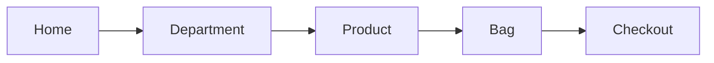

# FIELD

FIELD is a family clothing shop for denim, tees, fleece, and everyday layers.

**[Open the shop](http://localhost:5173)**

Jump to a section:

[Run it](#run-it) · [Walk the shop](#walk-the-shop) · [Departments](#departments) · [Bag and checkout](#bag-and-checkout) · [Help](#help)

## Run it

<details open>
<summary>Start the shop</summary>

```bash
npm install
npm run dev
```

Then open [http://localhost:5173](http://localhost:5173). If that port is already in use, Vite prints a different local URL. Use that one.

</details>

<details>
<summary>Build and preview</summary>

`npm run build` writes a production build to `dist`. `npm run preview` serves that build.

</details>

## Walk the shop



Check these off as you go:

- [ ] Open [the shop](http://localhost:5173)
- [ ] Choose a department and filter it, for example Women's jeans
- [ ] Open a product, pick a color and a size, and add it
- [ ] Open the bag and confirm the subtotal
- [ ] Place a demo order

## Departments

<details>
<summary>Women — denim, shirts, and coats</summary>

Tees, light-wash jeans, a chambray shirt, fleece, a sherpa denim jacket, a camel coat, and pull-on pants. [Shop women](http://localhost:5173/c/women)

</details>

<details>
<summary>Men — tees, denim, and easy layers</summary>

A heavyweight tee, straight jeans, an oxford, chinos, a bomber, and a fleece hoodie. [Shop men](http://localhost:5173/c/men)

</details>

<details>
<summary>Girls, boys, baby, and toddler</summary>

Smaller assortments for the rest of the family.

- [Girls](http://localhost:5173/c/girls)
- [Boys](http://localhost:5173/c/boys)
- [Baby](http://localhost:5173/c/baby)
- [Toddler](http://localhost:5173/c/toddler)

</details>

<details>
<summary>Sale</summary>

Markdowns show the original price struck through and the current price in red. [Shop sale](http://localhost:5173/c/sale)

</details>

## Bag and checkout

<details>
<summary>How the bag works</summary>

On a desktop, hover a product photo and pick a size to add it. On a product page, choose a color and a size first. The bag slides in from the side and stays in this browser.

Orders of $75 or more ship free. Under that, shipping is $8.

</details>

<details>
<summary>Place a demo order</summary>

Checkout asks for an email, a shipping address, and a card. You can use `4242 4242 4242 4242`, any future expiration, and any 3-digit CVC.

Nothing is charged, and no email is sent. The confirmation shows an order number that starts with `F-`.

</details>

## Help

<details>
<summary>Shipping, returns, and sizes</summary>

The Help page covers shipping, the 30-day return note, and the size chart from XS through XXL, plus baby and toddler sizes. [Open help](http://localhost:5173/help)

Search lives in the header. Try `jean`, `hoodie`, or `baby`. [Search](http://localhost:5173/search?q=jean)

</details>
